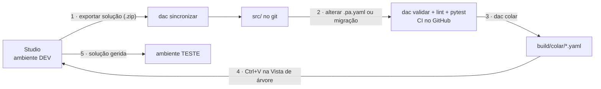

# Ciclo de vida da APP DAC2627 (ALM)

O código em `src/` é a fonte de verdade para ler, rever e alterar. O Power Apps Studio continua a ser o único sítio onde a app corre e é publicada. O ciclo liga os dois.



## 1. Do Studio para o git

1. No Studio, **Guardar** e **Publicar**. Publicar é obrigatório: a exportação da solução leva a última versão **publicada** da canvas app, não a guardada. A exportação 1.0.0.2 (16/11/2026) saiu igual, byte a byte, à 1.0.0.1, porque a v1.2.0 estava guardada mas não publicada. Em **Soluções › DAC2627 › DAC2627_RGJCA › Detalhes › Versões**, a versão com a marca **Live** é a que vai na exportação e a que os alunos abrem.
2. Em **Soluções › DAC2627 › Exportar**, exportar como **Não gerida** e descarregar o `.zip`.
3. No repositório:

```bash
python -m tools.dac sincronizar ~/Transferências/DAC2627_1_1_0_0.zip
```

```bash
git diff src/
```

```bash
make verificar
```

`sincronizar` substitui `solution/` e `msapp/`, guarda o zip em `_export/` e copia os `.pa.yaml` para `src/`. Os caminhos Windows do `.msapp` (`Src\App.pa.yaml`) são normalizados.

## 2. Alterar o código

- Pequenas alterações: editar o `.pa.yaml` diretamente.
- Alterações repetitivas ou em muitos controlos: escrever uma migração em `tools/migracoes/mNNN_*.py`, idempotente, como a `m001`. Fica documentado o que mudou e porquê, e a alteração pode ser repetida.
- Depois de cada alteração: `make verificar`. O CI (`.github/workflows/verificar.yml`) corre o mesmo em cada push.

## 3 e 4. Do git para o Studio

```bash
python -m tools.dac colar
```

Em `build/colar/` ficam:

| Ficheiro | Onde vai |
|---|---|
| `App.Formulas.pt.txt` | Propriedade **Formulas** do objeto **App** (substituir tudo). Já vem com `;` e `;;` |
| `scrXxx.yaml` | Um ecrã: apagar ou renomear o ecrã antigo, abrir o ficheiro, copiar tudo e fazer Ctrl+V na Vista de árvore |
| `TODOS_OS_ECRAS.yaml` | Todos os ecrãs de uma vez, pela ordem de `dac.yaml` |

`dac colar` também escreve `build/colar/LEIA-ME.txt`, a lista de verificação pela ordem certa, e compara as fontes de dados usadas no código com as da última exportação (`msapp/References/DataSources.json`). Com `--estrito`, falha se faltar uma fonte ou se uma apontar para a tabela errada.

A ordem, e porquê:

1. **Fontes de dados.** Confirmar em **Dados** que estão na app: `Cloud Service` (tabela `mcsft_cloudservices`), `Clientes`, `Pedidos` e o conector `JSONPlaceholderDAC`. O ambiente tem uma segunda tabela «Cloud Service» (`mcsft_cloudservice1`): ao adicionar, escolher a do nome lógico certo.
2. **`App.Formulas`** primeiro, porque os ecrãs usam os tokens. Colar ecrãs sem os tokens novos dá dezenas de erros (foram 24 na Ficha 03, a 16/11/2026).
3. **Apagar os ecrãs antigos.** Renomear só o ecrã não chega: os nomes dos controlos são únicos na app inteira, e o Studio poria `_1` nos controlos colados. Logo a seguir, voltar ao passo 1: apagar o último ecrã que usa uma fonte de dados pode tirá-la da app.
4. **Colar `TODOS_OS_ECRAS.yaml` de uma só vez.** O `scrInicio` navega para cinco ecrãs, e `scrL3Lista`, `scrL3Detalhe` e `scrL3Publicacao` passam `locL3Sel` e `locL3Pub` uns aos outros por `Navigate`. Colados um a um, a ordem errada deixa variáveis por definir (foi o que aconteceu com `locL3Pub`). Para mudar só alguns ecrãs, colá-los na mesma colagem.
5. **0 erros de fórmula**, e o Verificador de aplicações (ver os avisos esperados abaixo).
6. **Guardar e Publicar.** Nada avisa se não se publicar.
7. **Prova:** exportar (passo 1), `dac sincronizar` e `dac deriva`. Se `git diff src/` mostrar mais do que valores por omissão apagados, a colagem não ficou como o código.

O lint não substitui estes passos. A 10/11/2026 o lint estava a zero e o Studio mostrou 205 erros: o lint lê só o código e não sabe que fontes estão na app nem por que ordem se colou.

### O que o Studio muda ao guardar

O Studio apaga as propriedades iguais ao valor por omissão. Na exportação 1.0.0.3 foram 116 linhas: 86 × `TabIndex -1`, 15 × `AccessibleLabel ""`, 8 × `DropShadow.Light`, e algumas mais. A app fica igual, mas o código colado deixa de bater certo com o exportado. Por isso:

- `yamlio` não escreve esses valores (tabela `OMISSAO` em `tools/dac/yamlio.py`), e as migrações herdam isso.
- O lint lê uma propriedade ausente como o valor por omissão, e o DAC504 avisa quando o código escreve um.

### Avisos do Verificador que ficam de propósito

O Verificador marca todos os controlos com `TabIndex = -1` que não estejam numa galeria com `OnSelect = Select(Parent)`: 134 avisos «Tabulação em falta» na exportação 1.0.0.3, em etiquetas, ícones de estado, retângulos e nas cinco pílulas. A Microsoft manda pôr `-1` nos elementos não interativos ([Criar apps acessíveis](https://learn.microsoft.com/power-apps/maker/canvas-apps/accessible-apps)). Dar-lhes `TabIndex = 0` limparia o aviso e obrigaria quem usa o teclado a passar por cada texto. Ficam também 11 avisos de `AccessibleLabel` em retângulos e num ícone, todos decorativos. Os 43 avisos de foco invisível nas etiquetas dos formulários foram corrigidos na m003.

## 5. Ambientes e solução gerida

| Ambiente | Tipo de solução | Quem altera |
|---|---|---|
| DEV (o ambiente pessoal do aluno ou do docente) | Não gerida | Studio |
| TESTE (opcional, para demonstração) | Gerida | Só por importação |

Os fluxos `.github/workflows/alm-exportar.yml` e `alm-importar.yml` são **modelos** com as Power Platform Actions da Microsoft. Precisam de:

1. Um registo de aplicação no Microsoft Entra ID, com um segredo de cliente.
2. Esse registo como **Utilizador de aplicação** em cada ambiente (centro de administração do Power Platform › Ambiente › Definições › Utilizadores de aplicação), com a função **Administrador de Sistema**.
3. Os segredos `PP_APP_ID`, `PP_CLIENT_SECRET` e `PP_TENANT_ID`, e as variáveis `PP_ENV_DEV` e `PP_ENV_TESTE` no repositório do GitHub.

Não foram executados contra um ambiente real. Antes de os usar, confirme os nomes dos inputs na documentação das Power Platform Actions. Num tenant académico, o registo de aplicação costuma precisar de autorização do administrador de TI.

## Alternativas

- **Pipelines no Power Platform**: implementações entre ambientes sem GitHub, configuradas no próprio portal. Pedem ambientes geridos.
- **Integração Git nativa do Power Platform**: liga a solução diretamente a um repositório (Azure DevOps).
- **`pac` CLI** (`pac solution export`, `pac solution unpack`): o mesmo que os fluxos acima, à mão, a partir do terminal.

Fontes: [Power Platform Actions para GitHub](https://learn.microsoft.com/power-platform/alm/devops-github-actions), [Visão geral de ALM](https://learn.microsoft.com/power-platform/alm/overview-alm), [Código-fonte Power Fx YAML](https://learn.microsoft.com/power-apps/maker/canvas-apps/power-apps-yaml), [schema pa.yaml v3.0](https://github.com/microsoft/PowerApps-Tooling/tree/master/schemas/pa-yaml/v3.0).
