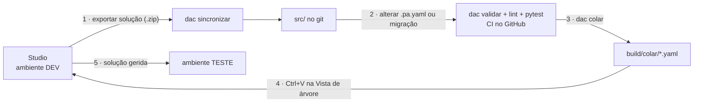

# Ciclo de vida da APP DAC2627 (ALM)

O código em `src/` é a fonte de verdade para ler, rever e alterar. O Power Apps Studio continua a ser o único sítio onde a app corre e é publicada. O ciclo liga os dois.



## 1. Do Studio para o git

1. No Studio, **Guardar** e **Publicar**.
2. Em **Soluções › DAC2627 › Exportar**, exportar como **Não gerida** e descarregar o `.zip`.
3. No repositório:

```bash
python -m tools.dac sincronizar ~/Transferências/DAC2627_1_1_0_0.zip
```

```bash
git diff src/
```

```bash
make verificar
```

`sincronizar` substitui `solution/` e `msapp/`, guarda o zip em `_export/` e copia os `.pa.yaml` para `src/`. Os caminhos Windows do `.msapp` (`Src\App.pa.yaml`) são normalizados.

## 2. Alterar o código

- Pequenas alterações: editar o `.pa.yaml` diretamente.
- Alterações repetitivas ou em muitos controlos: escrever uma migração em `tools/migracoes/mNNN_*.py`, idempotente, como a `m001`. Fica documentado o que mudou e porquê, e a alteração pode ser repetida.
- Depois de cada alteração: `make verificar`. O CI (`.github/workflows/verificar.yml`) corre o mesmo em cada push.

## 3 e 4. Do git para o Studio

```bash
python -m tools.dac colar
```

Em `build/colar/` ficam:

| Ficheiro | Onde vai |
|---|---|
| `App.Formulas.pt.txt` | Propriedade **Formulas** do objeto **App** (substituir tudo). Já vem com `;` e `;;` |
| `scrXxx.yaml` | Um ecrã: apagar ou renomear o ecrã antigo, abrir o ficheiro, copiar tudo e fazer Ctrl+V na Vista de árvore |
| `TODOS_OS_ECRAS.yaml` | Todos os ecrãs de uma vez, pela ordem de `dac.yaml` |

Regras práticas:
- Colar primeiro `App.Formulas`, porque os ecrãs usam os tokens novos (`nfBorda`, `nfVeu`...).
- O Studio só aceita a colagem com um Ctrl+V real do utilizador. Se o nome do ecrã já existir, cria `scrXxx_1`: apague o antigo antes de colar.
- No `scrL2Servicos`, o formulário `frmL2Servico` está ligado à tabela **Cloud Service**. Confirme que a fonte de dados já está na app antes de colar.
- No fim, corra o **Verificador de aplicações** e os testes da secção G2 do manual. Depois exporte (passo 1) e confirme com `dac deriva` que `src/` e a exportação coincidem.

## 5. Ambientes e solução gerida

| Ambiente | Tipo de solução | Quem altera |
|---|---|---|
| DEV (o ambiente pessoal do aluno ou do docente) | Não gerida | Studio |
| TESTE (opcional, para demonstração) | Gerida | Só por importação |

Os fluxos `.github/workflows/alm-exportar.yml` e `alm-importar.yml` são **modelos** com as Power Platform Actions da Microsoft. Precisam de:

1. Um registo de aplicação no Microsoft Entra ID, com um segredo de cliente.
2. Esse registo como **Utilizador de aplicação** em cada ambiente (centro de administração do Power Platform › Ambiente › Definições › Utilizadores de aplicação), com a função **Administrador de Sistema**.
3. Os segredos `PP_APP_ID`, `PP_CLIENT_SECRET` e `PP_TENANT_ID`, e as variáveis `PP_ENV_DEV` e `PP_ENV_TESTE` no repositório do GitHub.

Não foram executados contra um ambiente real. Antes de os usar, confirme os nomes dos inputs na documentação das Power Platform Actions. Num tenant académico, o registo de aplicação costuma precisar de autorização do administrador de TI.

## Alternativas

- **Pipelines no Power Platform**: implementações entre ambientes sem GitHub, configuradas no próprio portal. Pedem ambientes geridos.
- **Integração Git nativa do Power Platform**: liga a solução diretamente a um repositório (Azure DevOps).
- **`pac` CLI** (`pac solution export`, `pac solution unpack`): o mesmo que os fluxos acima, à mão, a partir do terminal.

Fontes: [Power Platform Actions para GitHub](https://learn.microsoft.com/power-platform/alm/devops-github-actions), [Visão geral de ALM](https://learn.microsoft.com/power-platform/alm/overview-alm), [Código-fonte Power Fx YAML](https://learn.microsoft.com/power-apps/maker/canvas-apps/power-apps-yaml), [schema pa.yaml v3.0](https://github.com/microsoft/PowerApps-Tooling/tree/master/schemas/pa-yaml/v3.0).
