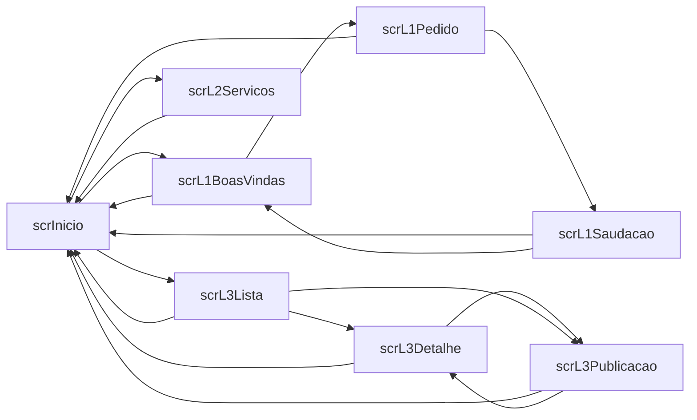

# Inventário da APP DAC2627

Gerado por `python -m tools.dac inventario` a partir de `src/`. Não editar à mão.

8 ecrãs e 204 controlos.

## Navegação



## Resumo por ecrã

| Ecrã | Controlos | Tipos mais usados | Variáveis | Dados |
|---|---:|---|---|---|
| `scrInicio` | 13 | Label 7, GroupContainer 4, Gallery 1, Button 1 | — | — |
| `scrL1BoasVindas` | 9 | GroupContainer 4, Label 3, Icon 1, Button 1 | — | — |
| `scrL1Pedido` | 12 | GroupContainer 5, Label 3, Icon 2, TextInput 1 | `gblL1Nome`, `locAviso` | — |
| `scrL1Saudacao` | 12 | GroupContainer 5, Label 3, Icon 2, Button 2 | `gblL1Nome` | — |
| `scrL2Servicos` | 69 | Label 27, GroupContainer 13, Button 9, TypedDataCard 5 | `locAcao`, `locMsg`, `locMsgTipo`, `locSel`, `locTentou`, `locTimer`, `locUltimaAcao` | Dataverse · Cloud Service |
| `scrL3Lista` | 39 | Label 12, GroupContainer 7, Button 7, Icon 5 | `colL3Publicacoes`, `colL3Utilizadores`, `locL3ACarregar`, `locL3Erro`, `locL3Vista` | Conector · JSONPlaceholderDAC |
| `scrL3Detalhe` | 34 | Label 17, GroupContainer 11, Icon 3, Button 1 | `colL3Publicacoes`, `locL3Sel` | — |
| `scrL3Publicacao` | 16 | Label 7, GroupContainer 5, Icon 2, Button 2 | `colL3Utilizadores`, `locL3Pub` | — |

## scrInicio

```
conEcraIn  [GroupContainer/AutoLayout]
  conCabIn  [GroupContainer/AutoLayout]
    lblCabIn  [Label]
  conConteudoIn  [GroupContainer/AutoLayout]
    lblInTitulo  [Label]
    lblInSubtitulo  [Label]
    galInFichas  [Gallery/Vertical]
      conInCartao  [GroupContainer/ManualLayout]
      lblInFicha  [Label]
      lblInFichaTitulo  [Label]
      lblInFichaDescricao  [Label]
      btnInAbrir  [Button]
    lblInRodape  [Label]
```

## scrL1BoasVindas

```
conEcraL1a  [GroupContainer/AutoLayout]
  conCabL1a  [GroupContainer/AutoLayout]
    icoInicioL1a  [Icon]
    lblCabL1a  [Label]
  conConteudoL1a  [GroupContainer/AutoLayout]
    conL1aCartao  [GroupContainer/AutoLayout]
      lblL1Titulo  [Label]
      lblL1Subtitulo  [Label]
      btnL1Comecar  [Button]
```

## scrL1Pedido

```
conEcraL1b  [GroupContainer/AutoLayout]
  conCabL1b  [GroupContainer/AutoLayout]
    icoInicioL1b  [Icon]
    icoL1Voltar  [Icon]
    lblCabL1b  [Label]
  conConteudoL1b  [GroupContainer/AutoLayout]
    conL1bCartao  [GroupContainer/AutoLayout]
      lblL1Pergunta  [Label]
      txtL1Nome  [TextInput]
      conL1Aviso  [GroupContainer/AutoLayout]
        lblL1Aviso  [Label]
      btnL1Saudar  [Button]
```

## scrL1Saudacao

```
conEcraL1c  [GroupContainer/AutoLayout]
  conCabL1c  [GroupContainer/AutoLayout]
    icoInicioL1c  [Icon]
    lblCabL1c  [Label]
  conConteudoL1c  [GroupContainer/AutoLayout]
    conL1cCartao  [GroupContainer/AutoLayout]
      icoL1Sucesso  [Icon]
      lblL1BoasVindas  [Label]
      lblL1Saudacao  [Label]
      conL1Botoes  [GroupContainer/AutoLayout]
        btnL1Alterar  [Button]
        btnL1Terminar  [Button]
```

## scrL2Servicos

```
conEcraL2  [GroupContainer/AutoLayout]
  conCabL2  [GroupContainer/AutoLayout]
    icoInicioL2  [Icon]
    lblCabL2  [Label]
  conConteudoL2  [GroupContainer/AutoLayout]
    conL2Barra  [GroupContainer/AutoLayout]
      txtL2Pesquisa  [TextInput]
      drpL2Modelo  [DropDown]
      lblL2Contagem  [Label]
      btnL2Novo  [Button]
    conL2Corpo  [GroupContainer/AutoLayout]
      conL2Lista  [GroupContainer/AutoLayout]
        lblL2Vazio  [Label]
        galL2Servicos  [Gallery/Vertical]
          lblL2ItemTitulo  [Label]
          lblL2ItemFornecedor  [Label]
          btnL2ItemModelo  [Button]
          recL2Separador  [Rectangle]
      conL2Painel  [GroupContainer/AutoLayout]
        conL2PainelTopo  [GroupContainer/AutoLayout]
          btnL2VoltarLista  [Button]
          lblL2PainelTitulo  [Label]
        conL2ErroGeral  [GroupContainer/AutoLayout]
          lblL2ErroGeral  [Label]
        frmL2Servico  [Form/Classic]
          Service Title_DataCard1  [TypedDataCard/ClassicTextualEdit]
            DataCardKey2  [Label]
            txtL2Titulo  [TextInput]
            ErrorMessage2  [Label]
            StarVisible2  [Label]
          Status_DataCard1  [TypedDataCard/ClassicComboBoxOptionSetSingleEdit]
            DataCardKey5  [Label]
            cmbL2Estado  [ComboBox]
            ErrorMessage5  [Label]
            StarVisible5  [Label]
          Provider_DataCard1  [TypedDataCard/ClassicTextualEdit]
            DataCardKey1  [Label]
            txtL2Fornecedor  [TextInput]
            ErrorMessage1  [Label]
            StarVisible1  [Label]
          Service Model_DataCard1  [TypedDataCard/ClassicComboBoxOptionSetSingleEdit]
            DataCardKey4  [Label]
            cmbL2Modelo  [ComboBox]
            ErrorMessage4  [Label]
            StarVisible4  [Label]
          Service Description_DataCard1  [TypedDataCard/ClassicTextualEdit]
            DataCardKey3  [Label]
            txtL2Descricao  [TextInput]
            ErrorMessage3  [Label]
            StarVisible3  [Label]
        lblL2PainelVazio  [Label]
        conL2Acoes  [GroupContainer/AutoLayout]
          btnL2Remover  [Button]
          lblL2Espaco  [Label]
          btnL2Cancelar  [Button]
          btnL2Editar  [Button]
          btnL2Guardar  [Button]
recL2Veu  [Rectangle]
conL2Dialogo  [GroupContainer/AutoLayout]
  lblL2ConfTitulo  [Label]
  lblL2ConfTexto  [Label]
  conL2ConfBotoes  [GroupContainer/AutoLayout]
    btnL2ConfCancelar  [Button]
    btnL2ConfOk  [Button]
conL2Mensagem  [GroupContainer/AutoLayout]
  icoL2MsgIcone  [Icon]
  lblL2Mensagem  [Label]
  icoL2FecharMsg  [Icon]
tmrL2Mensagem  [Timer]
```

## scrL3Lista

```
conEcraL3a  [GroupContainer/AutoLayout]
  conCabL3a  [GroupContainer/AutoLayout]
    icoInicioL3a  [Icon]
    lblCabL3a  [Label]
  conConteudoL3a  [GroupContainer/AutoLayout]
    conL3Separadores  [GroupContainer/AutoLayout]
      btnL3SepUtil  [Button]
      btnL3SepPub  [Button]
    conL3Barra  [GroupContainer/AutoLayout]
      txtL3Pesquisa  [TextInput]
      drpL3Utilizador  [DropDown]
      lblL3Contagem  [Label]
      btnL3Atualizar  [Button]
      btnL3Carregar  [Button]
    chkL3SimularFalha  [CheckBox]
    chkL3SimularVazio  [CheckBox]
    conL3Erro  [GroupContainer/AutoLayout]
      icoL3Aviso  [Icon]
      lblL3Erro  [Label]
      btnL3Repetir  [Button]
    conL3Aviso  [GroupContainer/AutoLayout]
      icoL3AvisoVazio  [Icon]
      lblL3Vazio  [Label]
      btnL3AvisoAtualizar  [Button]
    lblL3ACarregar  [Label]
    lblL3SemResultados  [Label]
    galL3Utilizadores  [Gallery/Vertical]
      btnL3Iniciais  [Button]
      lblL3ItemNome  [Label]
      lblL3ItemEmail  [Label]
      lblL3ItemEmpresa  [Label]
      icoL3Abrir  [Icon]
      recL3Separador  [Rectangle]
    galL3Publicacoes  [Gallery/Vertical]
      lblL3PubItemTitulo  [Label]
      lblL3PubItemAutor  [Label]
      lblL3PubItemResumo  [Label]
      icoL3PubAbrir  [Icon]
      recL3PubSeparador  [Rectangle]
```

## scrL3Detalhe

```
conEcraL3b  [GroupContainer/AutoLayout]
  conCabL3b  [GroupContainer/AutoLayout]
    icoInicioL3b  [Icon]
    icoL3Voltar  [Icon]
    lblCabL3b  [Label]
  conConteudoL3b  [GroupContainer/AutoLayout]
    lblL3SemSel  [Label]
    conL3bCartao  [GroupContainer/AutoLayout]
      conL3bTopo  [GroupContainer/AutoLayout]
        btnL3bIniciais  [Button]
        conL3bNomes  [GroupContainer/AutoLayout]
          lblL3Nome  [Label]
          lblL3Utilizador  [Label]
      conL3Blocos  [GroupContainer/AutoLayout]
        conL3Contacto  [GroupContainer/AutoLayout]
          lblL3TitContacto  [Label]
          lblL3Email  [Label]
          lblL3Telefone  [Label]
          lblL3Site  [Label]
        conL3Morada  [GroupContainer/AutoLayout]
          lblL3TitMorada  [Label]
          lblL3Rua  [Label]
          lblL3Cidade  [Label]
        conL3Empresa  [GroupContainer/AutoLayout]
          lblL3TitEmpresa  [Label]
          lblL3Empresa  [Label]
          lblL3Lema  [Label]
      conL3PubsUtil  [GroupContainer/AutoLayout]
        lblL3TituloPubs  [Label]
        galL3PubsUtil  [Gallery/Vertical]
          lblL3PubsUtilNum  [Label]
          lblL3PubsUtilItem  [Label]
          icoL3PubsUtilAbrir  [Icon]
          recL3PubsUtilSep  [Rectangle]
```

## scrL3Publicacao

```
conEcraL3c  [GroupContainer/AutoLayout]
  conCabL3c  [GroupContainer/AutoLayout]
    icoInicioL3c  [Icon]
    icoL3cVoltar  [Icon]
    lblCabL3c  [Label]
  conConteudoL3c  [GroupContainer/AutoLayout]
    lblL3SemPub  [Label]
    conL3cCartao  [GroupContainer/AutoLayout]
      lblL3PubNumero  [Label]
      lblL3PubTitulo  [Label]
      conL3PubAutor  [GroupContainer/AutoLayout]
        btnL3PubIniciais  [Button]
        lblL3PubAutor  [Label]
        btnL3VerAutor  [Button]
      lblL3PubTexto  [Label]
      lblL3PubNota  [Label]
```
