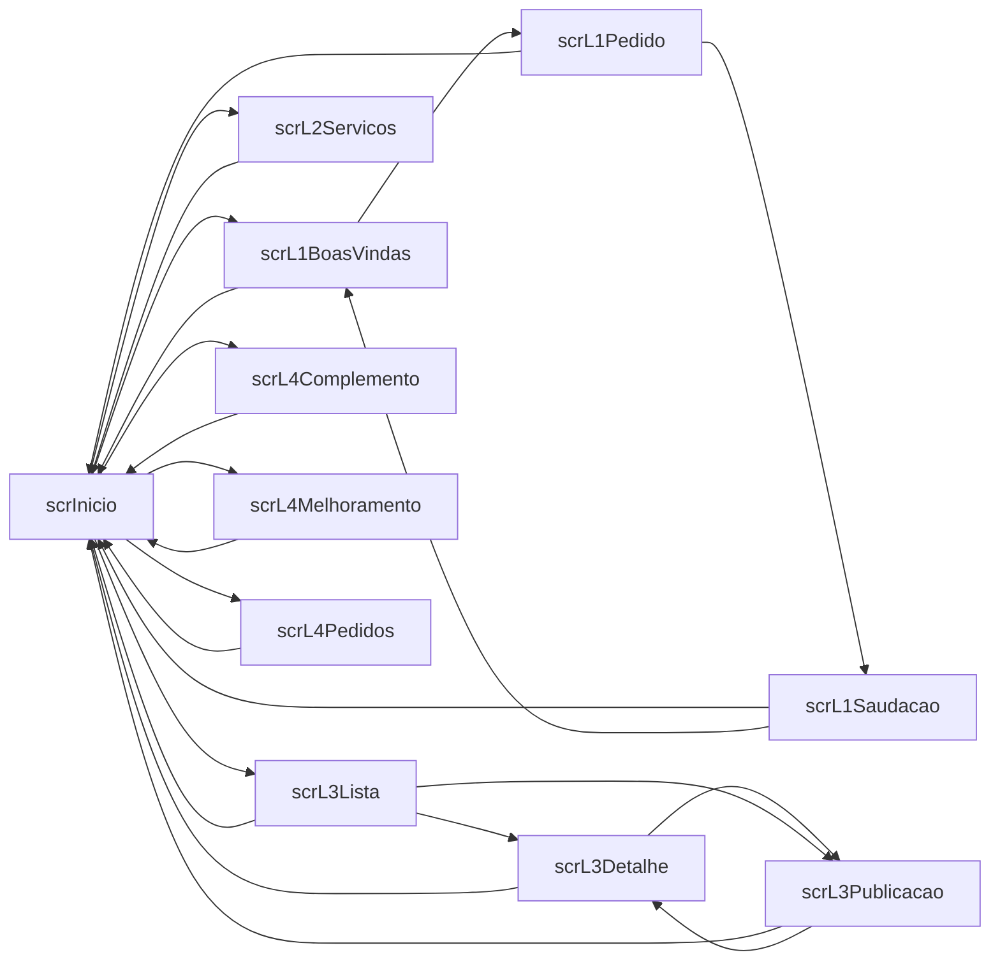

# Inventário da APP DAC2627

Gerado por `python -m tools.dac inventario` a partir de `src/`. Não editar à mão.

11 ecrãs e 473 controlos.

## Navegação



## Resumo por ecrã

| Ecrã | Controlos | Tipos mais usados | Variáveis | Dados |
|---|---:|---|---|---|
| `scrInicio` | 13 | Label 7, GroupContainer 4, Gallery 1, Button 1 | — | — |
| `scrL1BoasVindas` | 9 | GroupContainer 4, Label 3, Icon 1, Button 1 | — | — |
| `scrL1Pedido` | 12 | GroupContainer 5, Label 3, Icon 2, TextInput 1 | `gblL1Nome`, `locAviso` | — |
| `scrL1Saudacao` | 12 | GroupContainer 5, Label 3, Icon 2, Button 2 | `gblL1Nome` | — |
| `scrL2Servicos` | 89 | Label 40, GroupContainer 20, Button 9, TypedDataCard 5 | `locAcao`, `locMsg`, `locMsgTipo`, `locSel`, `locTentou`, `locTimer`, `locUltimaAcao` | Dataverse · Cloud Service |
| `scrL3Lista` | 39 | Label 12, GroupContainer 7, Button 7, Icon 5 | `colL3Publicacoes`, `colL3Utilizadores`, `locL3ACarregar`, `locL3Erro`, `locL3Vista` | Conector · JSONPlaceholderDAC |
| `scrL3Detalhe` | 34 | Label 17, GroupContainer 11, Icon 3, Button 1 | `colL3Publicacoes`, `locL3Sel` | — |
| `scrL3Publicacao` | 16 | Label 7, GroupContainer 5, Icon 2, Button 2 | `colL3Utilizadores`, `locL3Pub` | — |
| `scrL4Pedidos` | 103 | Label 44, Button 15, GroupContainer 13, TypedDataCard 9 | `locL4Acao`, `locL4Cliente`, `locL4Confirmar`, `locL4Modo`, `locL4Msg`, `locL4MsgTipo`, `locL4Painel`, `locL4Pedido`, `locL4Timer`, `locL4UltimaConf`, `locL4Vista` | — |
| `scrL4Complemento` | 91 | Label 75, GroupContainer 13, Button 2, Icon 1 | `locL4bVista` | — |
| `scrL4Melhoramento` | 55 | Label 20, GroupContainer 12, Button 12, Icon 3 | `locL4cAguardar`, `locL4cFiltro`, `locL4cMsg`, `locL4cMsgTipo`, `locL4cPedido`, `locL4cTentativas`, `locL4cTimer`, `locL4cValorTeste` | — |

## scrInicio

```
conEcraIn  [GroupContainer/AutoLayout]
  conCabIn  [GroupContainer/AutoLayout]
    lblCabIn  [Label]
  conConteudoIn  [GroupContainer/AutoLayout]
    lblInTitulo  [Label]
    lblInSubtitulo  [Label]
    galInFichas  [Gallery/Vertical]
      conInCartao  [GroupContainer/ManualLayout]
      lblInFicha  [Label]
      lblInFichaTitulo  [Label]
      lblInFichaDescricao  [Label]
      btnInAbrir  [Button]
    lblInRodape  [Label]
```

## scrL1BoasVindas

```
conEcraL1a  [GroupContainer/AutoLayout]
  conCabL1a  [GroupContainer/AutoLayout]
    icoInicioL1a  [Icon]
    lblCabL1a  [Label]
  conConteudoL1a  [GroupContainer/AutoLayout]
    conL1aCartao  [GroupContainer/AutoLayout]
      lblL1Titulo  [Label]
      lblL1Subtitulo  [Label]
      btnL1Comecar  [Button]
```

## scrL1Pedido

```
conEcraL1b  [GroupContainer/AutoLayout]
  conCabL1b  [GroupContainer/AutoLayout]
    icoInicioL1b  [Icon]
    icoL1Voltar  [Icon]
    lblCabL1b  [Label]
  conConteudoL1b  [GroupContainer/AutoLayout]
    conL1bCartao  [GroupContainer/AutoLayout]
      lblL1Pergunta  [Label]
      txtL1Nome  [TextInput]
      conL1Aviso  [GroupContainer/AutoLayout]
        lblL1Aviso  [Label]
      btnL1Saudar  [Button]
```

## scrL1Saudacao

```
conEcraL1c  [GroupContainer/AutoLayout]
  conCabL1c  [GroupContainer/AutoLayout]
    icoInicioL1c  [Icon]
    lblCabL1c  [Label]
  conConteudoL1c  [GroupContainer/AutoLayout]
    conL1cCartao  [GroupContainer/AutoLayout]
      icoL1Sucesso  [Icon]
      lblL1BoasVindas  [Label]
      lblL1Saudacao  [Label]
      conL1Botoes  [GroupContainer/AutoLayout]
        btnL1Alterar  [Button]
        btnL1Terminar  [Button]
```

## scrL2Servicos

```
conEcraL2  [GroupContainer/AutoLayout]
  conCabL2  [GroupContainer/AutoLayout]
    icoInicioL2  [Icon]
    lblCabL2  [Label]
  conConteudoL2  [GroupContainer/AutoLayout]
    conL2Barra  [GroupContainer/AutoLayout]
      txtL2Pesquisa  [TextInput]
      drpL2Modelo  [DropDown]
      lblL2Contagem  [Label]
      btnL2Novo  [Button]
    conL2Corpo  [GroupContainer/AutoLayout]
      conL2Lista  [GroupContainer/AutoLayout]
        lblL2Vazio  [Label]
        galL2Servicos  [Gallery/Vertical]
          lblL2ItemTitulo  [Label]
          lblL2ItemFornecedor  [Label]
          btnL2ItemModelo  [Button]
          recL2Separador  [Rectangle]
      conL2Painel  [GroupContainer/AutoLayout]
        conL2PainelTopo  [GroupContainer/AutoLayout]
          btnL2VoltarLista  [Button]
          lblL2PainelTitulo  [Label]
        conL2ErroGeral  [GroupContainer/AutoLayout]
          lblL2ErroGeral  [Label]
        frmL2Servico  [Form/Classic]
          Service Title_DataCard1  [TypedDataCard/ClassicTextualEdit]
            DataCardKey2  [Label]
            txtL2Titulo  [TextInput]
            ErrorMessage2  [Label]
            StarVisible2  [Label]
          Status_DataCard1  [TypedDataCard/ClassicComboBoxOptionSetSingleEdit]
            DataCardKey5  [Label]
            cmbL2Estado  [ComboBox]
            ErrorMessage5  [Label]
            StarVisible5  [Label]
          Provider_DataCard1  [TypedDataCard/ClassicTextualEdit]
            DataCardKey1  [Label]
            txtL2Fornecedor  [TextInput]
            ErrorMessage1  [Label]
            StarVisible1  [Label]
          Service Model_DataCard1  [TypedDataCard/ClassicComboBoxOptionSetSingleEdit]
            DataCardKey4  [Label]
            cmbL2Modelo  [ComboBox]
            ErrorMessage4  [Label]
            StarVisible4  [Label]
          Service Description_DataCard1  [TypedDataCard/ClassicTextualEdit]
            DataCardKey3  [Label]
            txtL2Descricao  [TextInput]
            ErrorMessage3  [Label]
            StarVisible3  [Label]
        conL2Ficha  [GroupContainer/AutoLayout]
          conL2FichaFactos  [GroupContainer/AutoLayout]
            conL2FichaFornecedor  [GroupContainer/AutoLayout]
              lblL2FichaFornecedorRotulo  [Label]
              lblL2FichaFornecedor  [Label]
              lblL2FichaFornecedorNota  [Label]
            conL2FichaModelo  [GroupContainer/AutoLayout]
              lblL2FichaModeloRotulo  [Label]
              lblL2FichaModelo  [Label]
              lblL2FichaModeloNota  [Label]
            conL2FichaEstado  [GroupContainer/AutoLayout]
              lblL2FichaEstadoRotulo  [Label]
              lblL2FichaEstado  [Label]
              lblL2FichaEstadoNota  [Label]
          lblL2FichaDescricaoTit  [Label]
          conL2FichaDescricao  [GroupContainer/AutoLayout]
            lblL2FichaDescricao  [Label]
          lblL2FichaResponsabilidadeTit  [Label]
          conL2FichaResponsabilidade  [GroupContainer/AutoLayout]
            lblL2FichaResponsabilidade  [Label]
        lblL2PainelVazio  [Label]
        conL2Acoes  [GroupContainer/AutoLayout]
          btnL2Remover  [Button]
          lblL2Espaco  [Label]
          btnL2Cancelar  [Button]
          btnL2Editar  [Button]
          btnL2Guardar  [Button]
recL2Veu  [Rectangle]
conL2Dialogo  [GroupContainer/AutoLayout]
  lblL2ConfTitulo  [Label]
  lblL2ConfTexto  [Label]
  conL2ConfBotoes  [GroupContainer/AutoLayout]
    btnL2ConfCancelar  [Button]
    btnL2ConfOk  [Button]
conL2Mensagem  [GroupContainer/AutoLayout]
  icoL2MsgIcone  [Icon]
  lblL2Mensagem  [Label]
  icoL2FecharMsg  [Icon]
tmrL2Mensagem  [Timer]
```

## scrL3Lista

```
conEcraL3a  [GroupContainer/AutoLayout]
  conCabL3a  [GroupContainer/AutoLayout]
    icoInicioL3a  [Icon]
    lblCabL3a  [Label]
  conConteudoL3a  [GroupContainer/AutoLayout]
    conL3Separadores  [GroupContainer/AutoLayout]
      btnL3SepUtil  [Button]
      btnL3SepPub  [Button]
    conL3Barra  [GroupContainer/AutoLayout]
      txtL3Pesquisa  [TextInput]
      drpL3Utilizador  [DropDown]
      lblL3Contagem  [Label]
      btnL3Atualizar  [Button]
      btnL3Carregar  [Button]
    chkL3SimularFalha  [CheckBox]
    chkL3SimularVazio  [CheckBox]
    conL3Erro  [GroupContainer/AutoLayout]
      icoL3Aviso  [Icon]
      lblL3Erro  [Label]
      btnL3Repetir  [Button]
    conL3Aviso  [GroupContainer/AutoLayout]
      icoL3AvisoVazio  [Icon]
      lblL3Vazio  [Label]
      btnL3AvisoAtualizar  [Button]
    lblL3ACarregar  [Label]
    lblL3SemResultados  [Label]
    galL3Utilizadores  [Gallery/Vertical]
      btnL3Iniciais  [Button]
      lblL3ItemNome  [Label]
      lblL3ItemEmail  [Label]
      lblL3ItemEmpresa  [Label]
      icoL3Abrir  [Icon]
      recL3Separador  [Rectangle]
    galL3Publicacoes  [Gallery/Vertical]
      lblL3PubItemTitulo  [Label]
      lblL3PubItemAutor  [Label]
      lblL3PubItemResumo  [Label]
      icoL3PubAbrir  [Icon]
      recL3PubSeparador  [Rectangle]
```

## scrL3Detalhe

```
conEcraL3b  [GroupContainer/AutoLayout]
  conCabL3b  [GroupContainer/AutoLayout]
    icoInicioL3b  [Icon]
    icoL3Voltar  [Icon]
    lblCabL3b  [Label]
  conConteudoL3b  [GroupContainer/AutoLayout]
    lblL3SemSel  [Label]
    conL3bCartao  [GroupContainer/AutoLayout]
      conL3bTopo  [GroupContainer/AutoLayout]
        btnL3bIniciais  [Button]
        conL3bNomes  [GroupContainer/AutoLayout]
          lblL3Nome  [Label]
          lblL3Utilizador  [Label]
      conL3Blocos  [GroupContainer/AutoLayout]
        conL3Contacto  [GroupContainer/AutoLayout]
          lblL3TitContacto  [Label]
          lblL3Email  [Label]
          lblL3Telefone  [Label]
          lblL3Site  [Label]
        conL3Morada  [GroupContainer/AutoLayout]
          lblL3TitMorada  [Label]
          lblL3Rua  [Label]
          lblL3Cidade  [Label]
        conL3Empresa  [GroupContainer/AutoLayout]
          lblL3TitEmpresa  [Label]
          lblL3Empresa  [Label]
          lblL3Lema  [Label]
      conL3PubsUtil  [GroupContainer/AutoLayout]
        lblL3TituloPubs  [Label]
        galL3PubsUtil  [Gallery/Vertical]
          lblL3PubsUtilNum  [Label]
          lblL3PubsUtilItem  [Label]
          icoL3PubsUtilAbrir  [Icon]
          recL3PubsUtilSep  [Rectangle]
```

## scrL3Publicacao

```
conEcraL3c  [GroupContainer/AutoLayout]
  conCabL3c  [GroupContainer/AutoLayout]
    icoInicioL3c  [Icon]
    icoL3cVoltar  [Icon]
    lblCabL3c  [Label]
  conConteudoL3c  [GroupContainer/AutoLayout]
    lblL3SemPub  [Label]
    conL3cCartao  [GroupContainer/AutoLayout]
      lblL3PubNumero  [Label]
      lblL3PubTitulo  [Label]
      conL3PubAutor  [GroupContainer/AutoLayout]
        btnL3PubIniciais  [Button]
        lblL3PubAutor  [Label]
        btnL3VerAutor  [Button]
      lblL3PubTexto  [Label]
      lblL3PubNota  [Label]
```

## scrL4Pedidos

```
conEcraL4  [GroupContainer/AutoLayout]
  conCabL4  [GroupContainer/AutoLayout]
    icoInicioL4  [Icon]
    lblCabL4  [Label]
  conConteudoL4  [GroupContainer/AutoLayout]
    conL4Barra  [GroupContainer/AutoLayout]
      txtL4Pesquisa  [TextInput]
      lblL4Contagem  [Label]
      btnL4TodosPedidos  [Button]
    conL4Corpo  [GroupContainer/AutoLayout]
      conL4Lista  [GroupContainer/AutoLayout]
        lblL4ListaTitulo  [Label]
        lblL4ListaVazia  [Label]
        galL4Clientes  [Gallery/Vertical]
          lblL4CliNome  [Label]
          lblL4CliInfo  [Label]
          icoL4CliSeta  [Icon]
          recL4CliSeparador  [Rectangle]
      conL4Painel  [GroupContainer/AutoLayout]
        conL4PainelTopo  [GroupContainer/AutoLayout]
          btnL4VoltarLista  [Button]
          lblL4PainelTitulo  [Label]
        lblL4ClienteDados  [Label]
        conL4Separadores  [GroupContainer/AutoLayout]
          btnL4SepTodos  [Button]
          btnL4SepPendentes  [Button]
          btnL4SepConcluidos  [Button]
        lblL4Resumo  [Label]
        lblL4SemPedidos  [Label]
        galL4Pedidos  [Gallery/Vertical]
          lblL4PedNumero  [Label]
          lblL4PedDescricao  [Label]
          lblL4PedValor  [Label]
          btnL4PedEstado  [Button]
          recL4PedSeparador  [Rectangle]
        frmL4Cliente  [Form/Classic]
          Nome_DataCard1  [TypedDataCard/ClassicTextualEdit]
            DataCardKey6  [Label]
            txtL4CliNome  [TextInput]
            ErrorMessage6  [Label]
            StarVisible6  [Label]
          NIF_DataCard1  [TypedDataCard/ClassicTextualEdit]
            DataCardKey9  [Label]
            txtL4CliNIF  [TextInput]
            ErrorMessage9  [Label]
            StarVisible9  [Label]
          Email_DataCard1  [TypedDataCard/ClassicTextualEdit]
            DataCardKey7  [Label]
            txtL4CliEmail  [TextInput]
            ErrorMessage7  [Label]
            StarVisible7  [Label]
          Telefone_DataCard1  [TypedDataCard/ClassicTextualEdit]
            DataCardKey8  [Label]
            txtL4CliTelefone  [TextInput]
            ErrorMessage8  [Label]
            StarVisible8  [Label]
        frmL4Pedido  [Form/Classic]
          Cliente_DataCard1  [TypedDataCard/ClassicComboBoxEdit]
            DataCardKey22  [Label]
            cmbL4PedCliente  [ComboBox]
            ErrorMessage21  [Label]
            StarVisible21  [Label]
            lblL4PedCliente  [Label]
          DataPedido_DataCard1  [TypedDataCard/ClassicDateEdit]
            DataCardKey15  [Label]
            dteL4PedData  [DatePicker]
            ErrorMessage15  [Label]
            StarVisible15  [Label]
          Estado (dac_estado)_DataCard1  [TypedDataCard/ClassicComboBoxOptionSetSingleEdit]
            DataCardKey17  [Label]
            cmbL4PedEstado  [ComboBox]
            ErrorMessage17  [Label]
            StarVisible17  [Label]
          Valor_DataCard1  [TypedDataCard/ClassicCurrencyEdit]
            DataCardKey19  [Label]
            txtL4PedValor  [TextInput]
            ErrorMessage18  [Label]
            StarVisible18  [Label]
          Descricao_DataCard1  [TypedDataCard/ClassicTextualMultilineEdit]
            DataCardKey16  [Label]
            txtL4PedDescricao  [TextInput]
            ErrorMessage16  [Label]
            StarVisible16  [Label]
        conL4Rodape  [GroupContainer/AutoLayout]
          btnL4RemoverCliente  [Button]
          btnL4EditarCliente  [Button]
          btnL4NovoCliente  [Button]
          btnL4NovoPedido  [Button]
          btnL4RemoverPedido  [Button]
          btnL4Cancelar  [Button]
          btnL4Guardar  [Button]
recL4Veu  [Rectangle]
conL4Dialogo  [GroupContainer/AutoLayout]
  lblL4ConfTitulo  [Label]
  lblL4ConfTexto  [Label]
  conL4ConfBotoes  [GroupContainer/AutoLayout]
    btnL4ConfCancelar  [Button]
    btnL4ConfOk  [Button]
conL4Mensagem  [GroupContainer/AutoLayout]
  icoL4MsgIcone  [Icon]
  lblL4Mensagem  [Label]
  icoL4FecharMsg  [Icon]
tmrL4Mensagem  [Timer]
```

## scrL4Complemento

```
conEcraL4b  [GroupContainer/AutoLayout]
  conCabL4b  [GroupContainer/AutoLayout]
    icoInicioL4b  [Icon]
    lblCabL4b  [Label]
  conConteudoL4b  [GroupContainer/AutoLayout]
    lblL4bTitulo  [Label]
    lblL4bIntro  [Label]
    lblL4bSpNome  [Label]
    lblL4bSpModelo  [Label]
    lblL4bSpOQue  [Label]
    lblL4bSpAprofTit  [Label]
    lblL4bSpAprof  [Label]
    lblL4bSpFavorTit  [Label]
    lblL4bSpFavor  [Label]
    lblL4bSpContraTit  [Label]
    lblL4bSpContra  [Label]
    lblL4bSpSintese  [Label]
    lblL4bDvNome  [Label]
    lblL4bDvModelo  [Label]
    lblL4bDvOQue  [Label]
    lblL4bDvAprofTit  [Label]
    lblL4bDvAprof  [Label]
    lblL4bDvFavorTit  [Label]
    lblL4bDvFavor  [Label]
    lblL4bDvContraTit  [Label]
    lblL4bDvContra  [Label]
    lblL4bDvSintese  [Label]
    lblL4bSqlNome  [Label]
    lblL4bSqlModelo  [Label]
    lblL4bSqlOQue  [Label]
    lblL4bSqlAprofTit  [Label]
    lblL4bSqlAprof  [Label]
    lblL4bSqlFavorTit  [Label]
    lblL4bSqlFavor  [Label]
    lblL4bSqlContraTit  [Label]
    lblL4bSqlContra  [Label]
    lblL4bSqlSintese  [Label]
    btnL4bVerTabela  [Button]
    lblL4bTabIntro  [Label]
    conL4bCabecalho  [GroupContainer/AutoLayout]
      lblL4bCabCriterio  [Label]
      lblL4bCabSharePoint  [Label]
      lblL4bCabDataverse  [Label]
      lblL4bCabSQL  [Label]
    conL4bLinha1  [GroupContainer/AutoLayout]
      lblL4bCrit1  [Label]
      lblL4bSp1  [Label]
      lblL4bDv1  [Label]
      lblL4bSql1  [Label]
    conL4bLinha2  [GroupContainer/AutoLayout]
      lblL4bCrit2  [Label]
      lblL4bSp2  [Label]
      lblL4bDv2  [Label]
      lblL4bSql2  [Label]
    conL4bLinha3  [GroupContainer/AutoLayout]
      lblL4bCrit3  [Label]
      lblL4bSp3  [Label]
      lblL4bDv3  [Label]
      lblL4bSql3  [Label]
    conL4bLinha4  [GroupContainer/AutoLayout]
      lblL4bCrit4  [Label]
      lblL4bSp4  [Label]
      lblL4bDv4  [Label]
      lblL4bSql4  [Label]
    conL4bLinha5  [GroupContainer/AutoLayout]
      lblL4bCrit5  [Label]
      lblL4bSp5  [Label]
      lblL4bDv5  [Label]
      lblL4bSql5  [Label]
    conL4bLinha6  [GroupContainer/AutoLayout]
      lblL4bCrit6  [Label]
      lblL4bSp6  [Label]
      lblL4bDv6  [Label]
      lblL4bSql6  [Label]
    conL4bLinha7  [GroupContainer/AutoLayout]
      lblL4bCrit7  [Label]
      lblL4bSp7  [Label]
      lblL4bDv7  [Label]
      lblL4bSql7  [Label]
    conL4bLinha8  [GroupContainer/AutoLayout]
      lblL4bCrit8  [Label]
      lblL4bSp8  [Label]
      lblL4bDv8  [Label]
      lblL4bSql8  [Label]
    conL4bLinha9  [GroupContainer/AutoLayout]
      lblL4bCrit9  [Label]
      lblL4bSp9  [Label]
      lblL4bDv9  [Label]
      lblL4bSql9  [Label]
    lblL4bConclusao  [Label]
    btnL4bVoltarTexto  [Button]
```

## scrL4Melhoramento

```
conEcraL4c  [GroupContainer/AutoLayout]
  conCabL4c  [GroupContainer/AutoLayout]
    icoInicioL4c  [Icon]
    lblCabL4c  [Label]
  conConteudoL4c  [GroupContainer/AutoLayout]
    lblL4cTitulo  [Label]
    lblL4cIntro  [Label]
    conL4cTopo  [GroupContainer/AutoLayout]
      conL4cNovo  [GroupContainer/AutoLayout]
        lblL4cNovoTitulo  [Label]
        lblL4cClienteRot  [Label]
        cmbL4cCliente  [ComboBox]
        lblL4cValorRot  [Label]
        txtL4cValor  [TextInput]
        conL4cTestes  [GroupContainer/AutoLayout]
          lblL4cTestesRot  [Label]
          btnL4cTeste100  [Button]
          btnL4cTeste500  [Button]
          btnL4cTeste750  [Button]
        lblL4cDescRot  [Label]
        txtL4cDescricao  [TextInput]
        chkL4cSemValor  [CheckBox]
        btnL4cRegistar  [Button]
      conL4cEstado  [GroupContainer/AutoLayout]
        lblL4cEstadoTitulo  [Label]
        lblL4cSemPedido  [Label]
        conL4cResumo  [GroupContainer/AutoLayout]
          lblL4cNumero  [Label]
          btnL4cTratamento  [Button]
        lblL4cAguarda  [Label]
        lblL4cDetalhes  [Label]
        lblL4cDecisao  [Label]
        conL4cAcoes  [GroupContainer/AutoLayout]
          btnL4cAtualizar  [Button]
          btnL4cReprocessar  [Button]
    lblL4cListaTitulo  [Label]
    conL4cFiltros  [GroupContainer/AutoLayout]
      btnL4cFiltroTodos  [Button]
      btnL4cFiltroAuto  [Button]
      btnL4cFiltroRevisao  [Button]
      btnL4cFiltroErro  [Button]
    lblL4cListaVazia  [Label]
    conL4cListaCartao  [GroupContainer/AutoLayout]
      galL4cPedidos  [Gallery/Vertical]
        lblL4cGNumero  [Label]
        lblL4cGObs  [Label]
        lblL4cGValor  [Label]
        btnL4cGTratamento  [Button]
        recL4cGSeparador  [Rectangle]
conL4cMensagem  [GroupContainer/AutoLayout]
  icoL4cMsgIcone  [Icon]
  lblL4cMensagem  [Label]
  icoL4cFecharMsg  [Icon]
tmrL4cMensagem  [Timer]
tmrL4cEstado  [Timer]
```
